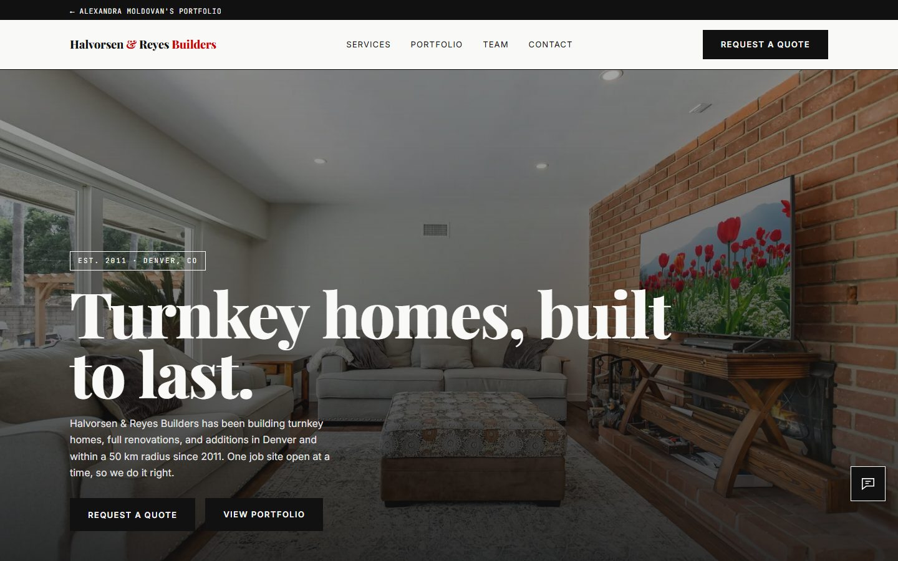

# Halvorsen & Reyes Builders — site



Public, one-page site for the fictional construction company Halvorsen & Reyes Builders (Denver, CO). "Vibe Coding" theme — stepIT.

**Live:** https://halvorsen-reyes-builders-655f70.netlify.app/

> **AI chatbot status:** the Anthropic key is switched off between live demos to keep running costs at zero, so the chat answers from a short scripted fallback, labelled as such on the page. The quote form and the database are live.

> The code in this folder is one step ahead of the live site (performance optimizations that couldn't be published to production yet) — see the [Performance (Lighthouse)](#performance-lighthouse) section.

## Stack

- **Frontend**: vanilla HTML/CSS/JS (no framework, no build step), GSAP + ScrollTrigger animations, hosted statically on **Netlify**.
- **Backend**: **Supabase** — `leads` table (RLS: public INSERT only) + `chat` Edge Function (Deno) that calls the Anthropic API with the key kept secret in Supabase. The chatbot and the form have **usage limits** (see [below](#usage-limits-added-after-submission)).
- **Design**: `DESIGN.md` — an adaptation of the Newsprint style (designprompts.dev) for a vanilla stack, with a black/white + editorial red palette, Playfair Display + Lora + Inter + JetBrains Mono typography, self-hosted in `fonts/` (see `fonts/README.md`).
- **Images**: WebP, max 1600px width for large photos (projects + team); portfolio thumbnails have their own 480px variants (`*-thumb.webp`), generated separately, so the 1600px file isn't downloaded for a photo shown at ~150px. All below-the-fold images have `loading="lazy"`. In the carousel, photos for projects 2–5 only load once you reach them (plus the next project, after the page loads).

## Structure

```
index.html              the site (one page)
styles.css               styles, tokens from DESIGN.md
logic.js                 the pure logic (no page, no network): form checks, the row sent, chatbot fallback answers, photo viewer step, theme choice
theme-init.js            sets the dark/light theme before the page is drawn (loaded in <head>, with logic.js)
script.js                mobile nav, GSAP animations, photo viewer, theme button, form, chatbot (the page side)
config.js                Supabase URL + anon key (fill in after setup)
tests/                   unit tests for logic.js (node --test)
images/                  optimized photos (projects + team)
fonts/                   the site's fonts (latin + diacritics subset), OFL license
admin.html, admin.js     admin panel (Erik & Camila) — login + request list, outside the brief
supabase/schema.sql       leads table + RLS, admins table + RLS for the admin panel
supabase/functions/chat/  Edge Function for the chatbot (with a message limit)
supabase/rate_limits.sql  usage limits: chatbot 20/hour/visitor + 300/day, form 30/hour + 3/day/email
SUPABASE_SETUP.md         manual setup steps (one time)
deploy/                   a copy with ONLY the site's files, for Netlify: `netlify deploy --prod --dir deploy` (keep index.html, styles.css, logic.js, theme-init.js, script.js, config.js identical to the root ones)
CLAUDE.md, DESIGN.md      context and design decisions for Claude Code
docs/screenshot.jpg       the picture at the top of this README (not part of the site)
```

## Tests

```bash
node --test "tests/*.test.js"
```

19 unit tests for `logic.js`: the quote form's checks (all five required fields, phone numbers with spaces or brackets, what counts as an email, spaces not counting toward the minimum length), the row sent to Supabase (trimmed, an unchosen budget sent as null, only the six table columns whatever else the form holds), the check for an unconfigured `config.js`, the chatbot's local fallback (cost questions never get a price, only the way to a quote), the photo viewer's next/previous step (wrapping around), and the theme choice (a saved choice wins over the system setting). Plain Node, nothing to install, no Supabase; they run in CI on every push. The server side (RLS on `leads`, the `chat` function and its limits) was checked on the live project, see the acceptance test below.

## Quick setup

See `SUPABASE_SETUP.md` — create the Supabase project, run `schema.sql`, deploy the `chat` function, set the Anthropic key as a secret, fill in `config.js`, then deploy to Netlify.

## Claude Code plugins used

*(filled in after the plugin-installation step in Claude Code — at least 3 plugins, at least 2 marketplaces)*

| Plugin | Marketplace | What it concretely did for this site |
|---|---|---|
| `frontend-design` | `claude-plugins-official` | Review of `index.html` + `styles.css` against `DESIGN.md`. Found and fixed: invisible focus on form fields (`#F0F0F0` on `#F9F9F7`, ~1.05:1) and on black backgrounds (hero, contact, chat header); a skip link that never became visible; tap targets under 44px (the chat close button, the carousel dots); `border-radius: 50%` on the chatbot avatar (contrary to the "0 everywhere" rule); Playfair Display weight 800 required in CSS but not loaded from Google Fonts; token `--neutral-400` used but undefined; focus not returned when the form closed. |
| `security-guidance` | `claude-plugins-official` | A hook-based plugin: automatically checks every file Claude edits against ~25 dangerous patterns (XSS, hardcoded secrets, unsafe deserialization, etc.). I ran its pattern checker across all the code (`config.js`, `script.js`, `admin.js`, `index.html`, `admin.html`, `supabase/schema.sql`, `supabase/functions/chat/index.ts`). **Found no secret key** in the code. It flagged 3 things: (1) GSAP scripts from cdnjs with no Subresource Integrity → fixed, added `integrity` + `crossorigin`; (2) `innerHTML` in `script.js` for the hero title → fixed, rebuilt with DOM nodes; (3) `innerHTML` in `admin.js` → checked manually, false positive (all fields go through `escapeHtml`). Its LLM review of diffs and of commits needs a git repo, and the project wasn't a git repo yet at that point. |
| `commit-commands` | `claude-plugins-official` | Installed and available for local commits (`/commit`, `/commit-push-pr`), but not used yet — the project wasn't a git repo yet at that point. |
| `impeccable` | `pbakaus/impeccable` (a separate marketplace, not `claude-plugins-official`) | Design/quality audit with `/impeccable audit`: ran a deterministic detector (61 rules) plus a direct in-browser check, at 1440px and 375px, repeated 5 times as I fixed what it found. Score: 14 → 17 → 18 → 19 → **20/20**. What it actually found, in order: (1) Tab order left the quote form and landed on hidden background elements; a chat field with no `aria-label`; chatbot replies weren't announced to screen readers; insufficient contrast on the hero text; all images served the 1600px variant including thumbnails shown at 54–152px, with no `loading="lazy"`; (2)-(3) smaller focus/contrast/text-size issues left after round 1; the drop cap was overlapping the founders' names; (4)-(5) the team photo not aligned with the rest of the section (`<figure>` with no `margin:0`), menu jumps landing under the fixed header (no `scroll-padding-top`), and one content issue the audit explicitly flagged as a decision of mine, not a code bug: the photo caption named "Erik & Camila", but the stock photo shows three unidentified men — I rewrote the caption generically (it no longer claims specific identities) and separately corrected a visible lens distortion in the stock photo (`cv2.undistort`, coefficient -0.15, then cropped to remove the resulting black edges). I checked every flagged issue by hand (contrast actually measured, not just read off the report) and applied every real fix; a few final P3 signals (a doubled 1-3px line under the header on scroll — `scroll-padding-top` was about 1px larger than the real header) were fixed directly, measuring the header's real height with Playwright instead of guessing the value. Verified with Playwright after every change, not just run blindly. |

## Performance (Lighthouse)

The brief's requirement: Performance ≥ 85, Accessibility ≥ 90. Measured with PageSpeed Insights (Lighthouse), on 2026-09-24:

| Version | Mobile — Performance | Desktop — Performance | Accessibility | Best Practices |
|---|---|---|---|---|
| **Live** (link above) | 69 | 96 | 100 | 96 |
| **Code in this folder** (checked on a Netlify draft deploy, 2 runs) | **93** | **100** | 100 | 100 |

Draft checked: https://6ab52dcb5fd9a02f6634399b--halvorsen-reyes-builders-655f70.netlify.app/ — same code as in the folder. SEO comes out at 63 on the draft only because Netlify automatically marks draft deploys with `noindex`; it's 100 on live. The draft serves only as proof for Lighthouse: the chatbot only replies on the live link (the `chat` function only accepts origins from `ALLOWED_ORIGINS`).

**Why the optimized code isn't live yet:** on the Free plan, Netlify blocked production deploys after the monthly credits ran out (`netlify deploy --prod` → `Forbidden`; only "operational credits" remain, which keep the site online). Draft deploys don't consume credits, which is why the optimizations could be verified there. The code goes live on the first production deploy after the credit reset, with no further changes needed.

**What changed versus live** (and how much it mattered, on mobile):

1. **Carousel photos** — before, opening the page downloaded the photos for all 5 projects (22 images, ~559 KB) and competed with the hero photo. Now only project 1 (7 images, ~245 KB); the rest load on navigation. LCP: 5.5s → 4.3s.
2. **Locally hosted fonts** — Google Fonts pulled in 8 files (~296 KB) from 2 extra domains. Now 7 files (~145 KB), generated from the official sources with only the weights actually used. FCP: 3.8s → 2.0s, LCP: 4.3s → 2.5s.
3. **No layout shift on font load** — the hero title's width was in `ch` (a unit that depends on the current font), so it jumped from 3 lines to 2 when Playfair loaded (CLS 0.32 on desktop). Widths are now in `em`, and the fallback fonts have adjusted metrics (`size-adjust`). Desktop CLS: 0.32 → 0.002.
4. Scripts with `defer`, `preconnect` to cdnjs. The exception, added later with the dark theme: `logic.js` (pure functions, ~4 KB) and `theme-init.js` (a few lines) load in `<head>`, so the theme is set before the first paint instead of flashing.
5. Two visual bugs found along the way: the team photo and the portfolio thumbnails came out stretched/tall on narrow screens (the HTML `height` attribute was overriding `aspect-ratio`) — fixed with `height: auto`.

## Usage limits (added after submission)

Added on 2026-09-24, after the assignment was submitted. The `chat` function and the form can be called by anyone who has the public key from the site (`config.js`), so without limits someone could loop messages against the Anthropic key or flood `leads` with spam. The limits live in **Supabase**, so no Netlify deploy was needed.

| What | Limit | Where |
|---|---|---|
| **Chatbot, per visitor** | **20 messages per hour** | `chat_allow()` in `supabase/rate_limits.sql`, called from the `chat` function **before** Anthropic |
| **Chatbot, total** | **300 messages per day** | same |
| **Form, total** | **30 requests per hour** | `leads_rate_limit` trigger on the `leads` table |
| **Form, per email** | **3 requests per day** | same |

- **Over the chatbot limit**, the visitor gets a normal chat reply ("chat is paused…") pointing them to the form, and **Anthropic is never called**. The existing site displays it with no changes.
- **Privacy:** the visitor is recognized by a **fingerprint (SHA-256 hash) of their IP**, not by the IP itself. Fingerprints live in the `chat_usage` table (RLS on, no policies: unreachable from the site) and are deleted after 2 days.
- **If the check can't be performed** (e.g. the database isn't responding), the chatbot **refuses** the message instead of passing it through. There's no spending limit set in the Anthropic Console, so the limit in the code is the only cost protection.
- **Limits can be changed without touching code**, via the function's secrets: `CHAT_LIMIT_PER_HOUR`, `CHAT_LIMIT_PER_DAY`.
- **Verification:** the SQL was tested on local Postgres (run twice — the hourly/daily/per-email limits, the `anon` key can't call the function and can't read the table). Live: the first message showed up in `chat_usage`, and with `CHAT_LIMIT_PER_HOUR=2` the chatbot replied with the pause message at the limit; the secret was deleted after the test.
- Setup steps: `SUPABASE_SETUP.md`, step 10.

## Known limits of the chatbot

What the design above does not guarantee, stated so nobody has to discover it:

- **One question, one answer.** The function sends only the current message to the model (`messages: [{ role: "user", ... }]`), with no conversation history. It's simpler and cheaper, but a follow-up like "and the second one?" loses the context.
- **Prompt injection is only guarded by the system prompt.** It tells the model to talk only about the company and to decline everything else. A determined visitor can still try to push it off-topic. What limits the damage: the reply is shown as plain text (`textContent` in `script.js`), so it can't inject HTML into the page, and the function can only return text: it has no access to the database or to anything else.
- **CORS is not access control.** `ALLOWED_ORIGINS` (set on the live function to the site's own address) only stops *other websites' browser code* from calling the chat. A script outside a browser can still call it with the public key from `config.js`; that's what the usage limits are for.
- **The per-visitor limit follows the IP.** A visitor who changes IP (VPN, mobile data) gets a new 20-per-hour allowance. The 300-per-day total still caps all visitors together, and with `max_tokens: 400` per reply that total is the ceiling on daily cost.

## Deviations from the brief (documented)

What wasn't done exactly as in the assignment PDF / the "References and animations" guide, and why:

1. **The Supabase MCP server was only added at the very end.** The tables, RLS, and the `chat` function were created manually: `supabase/schema.sql` run in the SQL Editor (a file versioned in the project), the function's code pasted in from the dashboard. That's why the migrations list in Supabase is empty. At the end I added the official Supabase MCP in **read-only** mode (`.mcp.json`) and used it to verify:
   - `leads`: RLS on, INSERT policy for `anon` only, SELECT only for authenticated admins (`is_admin()`); CHECK constraints on every field.
   - `admins`: RLS on, no policies — intentional, not reachable via the API, read only by `is_admin()`.
   - Security advisors: **0 errors**, 2 minor warnings, left intentionally: `is_admin()` is `SECURITY DEFINER` and callable by logged-in users (it only tells them whether they themselves are admins; the function has to stay executable, or the admin read policy stops working), and leaked-password protection is turned off (it only matters for the admin accounts).
2. **`REFERENCE.md` was written after the build, not before.** The design starts from `DESIGN.md` and the photos; the analysis of the reference site (thorsenconstruction.us, with Playwright MCP) was done afterward, as documentation. No text, photos, or code were copied.
3. **The hero title animation runs on page load, not scrubbed.** The other animations are scroll-tied (the hero shrink and photo parallax use `scrub`, the portfolio reveal on scroll). A title hidden until the first scroll would have left the hero with no title on open.
4. **The portfolio is an arrow-driven carousel, not a pinned horizontal-scroll section**, with no Lenis and no rounded corners on the hero — design decisions (the page scroll stays strictly vertical; `DESIGN.md` calls for square corners). `prefers-reduced-motion` is respected: with that option on, the GSAP animations don't start and the content is visible immediately.
5. **Photos are served from Netlify**, not from Supabase Storage (as shown in the architecture diagram) — they're static site files, already optimized as WebP.
6. **The project wasn't a git repo** at submission time, so there was no commit history then.

## Acceptance test

Checked on the live site, 2026-09-24.

- [x] Public URL loads; no horizontal scroll at 375px width
- [x] All 5 projects appear with their own photos and description; the team section shows the photo
- [x] Chat: "Who are the owners?" → Erik Halvorsen and Camila Reyes
- [x] Chat: "What projects have you done?" → the 5 of them, with correct names
- [x] Chat: "How much does a 150 sqm house cost?" → doesn't make up a price, points to the form
- [x] Chat: "Write me a poem" → politely declines
- [x] View Source / Network: the Anthropic key doesn't appear anywhere
- [x] Form submitted → the row appears in the `leads` table
- [x] Form with an empty or invalid email → rejected, with a clear message
- [x] With the `anon` key, SELECT on `leads` returns 0 rows
- [x] Lighthouse: Accessibility ≥ 90 — 100 (mobile)
- [ ] Lighthouse: Performance ≥ 85 — on live: desktop 96 ✅, mobile 69 ❌; on the code in this folder (draft): mobile 93 ✅, desktop 100 ✅ — see [Performance (Lighthouse)](#performance-lighthouse)
- [x] README.md: ≥ 3 plugins, ≥ 2 marketplaces, each one's role
